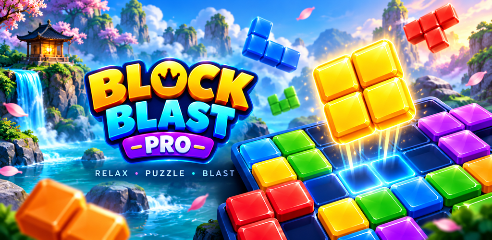
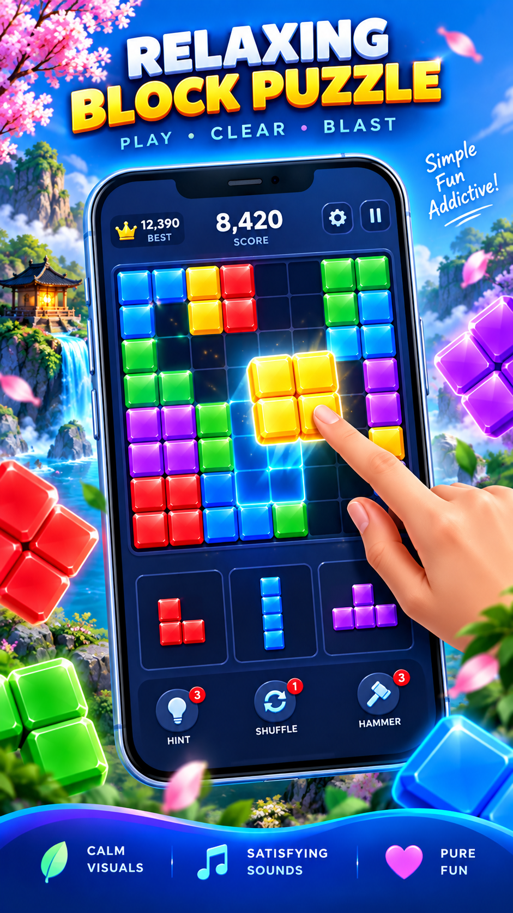
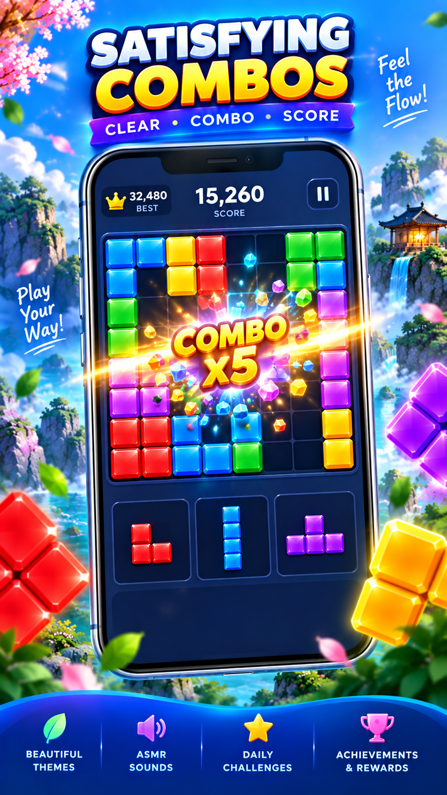
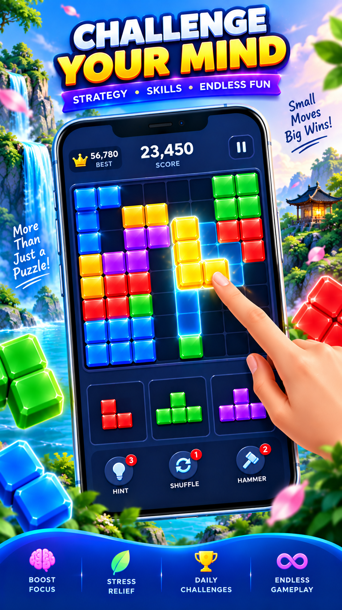
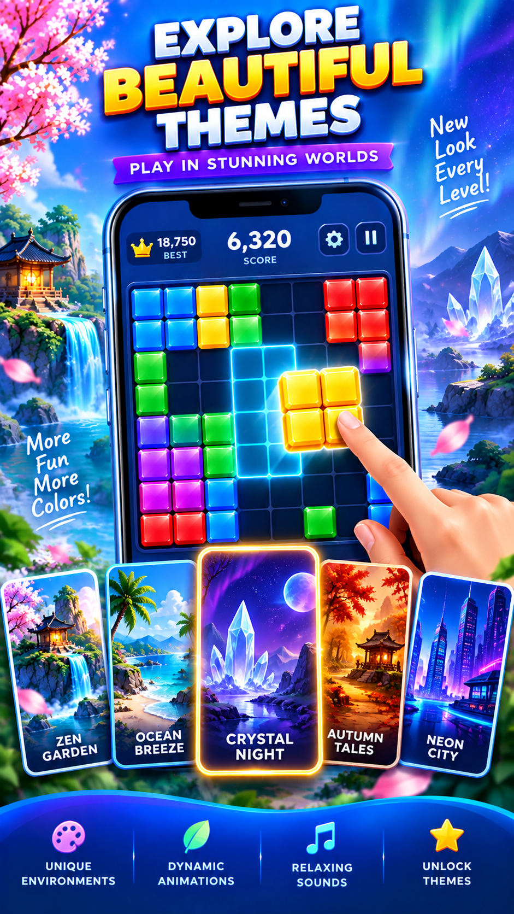
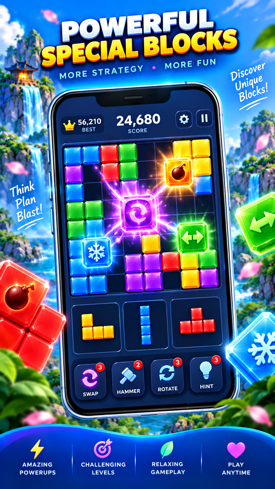

# Block Blast Pro 🎮

<div align="center">

<a href="https://play.google.com/store/apps/details?id=com.block.blastpro" target="_blank">
  
</a>

<br/>

[](https://flutter.dev)
[](https://dart.dev)
[](https://flutter.dev)
[](https://play.google.com/store/apps/details?id=com.block.blastpro)

</div>

<br/>

<p align="center">
  
</p>

**Block Blast Pro** is a next-generation casual spatial block-puzzle mobile game engineered with Flutter and Dart. Designed with a custom Pixar-inspired 3D tactile aesthetic, dynamic grid-shifting mechanics, multi-tier combo algorithms, and an ASMR-tuned haptic audio engine.

---

## 📱 Google Play Store Screenshots

<div align="center">

| Classic & Combos | Dynamic Grid Shifts | Heavy Physics | Daily Challenges | Theme Gallery & Skins |
|:---:|:---:|:---:|:---:|:---:|
|  |  |  |  |  |

</div>

<br/>

<div align="center">
  <a href="https://play.google.com/store/apps/details?id=com.block.blastpro" target="_blank">
    
  </a>
</div>

---

## ✨ Features

- **9 Distinct Game Modes:**
  - `Classic Mode`: Pure spatial puzzle placement with combo survival.
  - `Dynamic Grid`: Board boundaries actively shift based on density and combo streaks.
  - `Heavy Physics`: Weighted pieces with tactile impact shockwaves and board pressure.
  - `Zen Mode`: Relaxing, fail-safe puzzle flow accompanied by peaceful ambient soundscapes.
  - `Daily Challenge`: Deterministic calendar-based puzzle challenges generated via cryptographic salt.
  - `Blitz Mode`: 60-second high-intensity race with time-extension clears.
  - `Custom Mode`: Player-adjustable board rules, physics constants, and grid parameters.
  - `Journey Campaign`: Multi-stage adventure with progressive level goals and 3-star ratings.
  - `Rising Lava`: Survival arcade where rising magma must be pushed down by clearing lines.

- **Tactile ASMR & Haptics Engine:**
  - Multi-octave wooden click, glass chime, and stone snap audio synthesis.
  - Haptic feedback integration with customizable vibration intensities (`subtle`, `crisp`, `heavy`).

- **18 Specialized Puzzle Blocks:**
  - TNT Explosive Blocks, Laser Beam Blasters, Gravity Blocks, Magnetic Attractors, Prism Rainbow Wildcards, Tesla Lightning Conductors, Frozen Ice Shells, and more.

- **Visual Customization & Skins:**
  - 11 render themes: Gem, Neon, Candy, Woodcraft, Obsidian, Midas Gold, Volcanic Magma, Cyberpunk, Bioluminescence, Retro Arcade, and Cosmic Starlight.

- **Monetization & Services Integration:**
  - **In-App Billing**: Optional `$4.99 / month` "Remove Ads" auto-renewing subscription via Google Play Billing.
  - **Ad Mediation**: Google Mobile Ads (AdMob) with Unity Ads mediation for banners, interstitials (with 60-second cooldown protection), and rewarded video revives.
  - **Google Play Games Services**: Cloud leaderboards, achievements, and player rank tiers.
  - **Google Play In-App Updates**: In-game prompt flow for seamless patch and version deployments.

---

## 🛠️ Tech Stack & Architecture

- **Framework:** Flutter 3.13+ / Dart 3
- **Engine Components:** Flame 1.38+ for high-performance canvas rendering & particle system
- **State Management:** Layered Coordinator & Repository architecture with `ChangeNotifier`
- **Audio & Haptics:** `audioplayers` 6.8+ with low-latency sound caching
- **Storage:** Local encrypted preference persistence via `shared_preferences`
- **Monetization:** `google_mobile_ads`, `gma_mediation_unity`, `in_app_purchase`

---

## 📂 Project Structure

```text
lib/
├── core/
│   ├── ads/          # AdMob & Unity mediation services
│   ├── audio/        # ASMR procedural & sample audio engine
│   ├── billing/      # Google Play In-App purchase & subscription handling
│   ├── constants/    # Board, scoring, and difficulty constants
│   ├── services/     # Rating, updates, and Play Games integration
│   └── theme/        # Color palettes, gradients, and Pixar 3D design tokens
├── data/
│   └── repositories/ # Local storage and preference persistence
├── domain/
│   ├── models/       # Game state, board cells, pieces, and game modes
│   └── services/     # Grid shift, piece generation, and difficulty engines
├── game/
│   ├── components/   # Custom board canvas, piece trays, and particle physics
│   └── game_coordinator.dart  # Central game controller & loop
└── presentation/
    ├── screens/      # Game screen, settings, leaderboards, policy & terms
    └── widgets/      # 3D Pixar buttons, cards, appbars, and radar charts
```

---

## 🚀 Getting Started

### Prerequisites

- Flutter SDK (version 3.13.0 or higher)
- Android SDK (minSdk: 24, targetSdk: 34+)
- Java JDK 17
- Android Studio or VS Code with Flutter extension

### Installation

1. **Clone the repository:**
   ```bash
   git clone https://github.com/OPSHARP/block-blast-pro.git
   cd block-blast-pro
   ```

2. **Install Flutter dependencies:**
   ```bash
   flutter pub get
   ```

3. **Android Signing Configuration:**
   Copy the example properties file and provide your local credentials:
   ```bash
   cp android/key.properties.example android/key.properties
   ```
   Edit `android/key.properties` with your signing key path and passwords.

4. **Run in Debug Mode:**
   ```bash
   flutter run
   ```

---

## 🔒 Security & Privacy Notice

- Sensitive production signing keys and local machine properties are strictly omitted from this repository in accordance with [.gitignore](.gitignore).
- Privacy disclosures and Terms of Service are integrated directly within the application's Settings menu.

---

## 📄 License & Attribution

Copyright (c) 2026 SHARP OP (Proprietor: Nitesh Kumar). All rights reserved.
Distributed via Google Play Store for Android devices.
